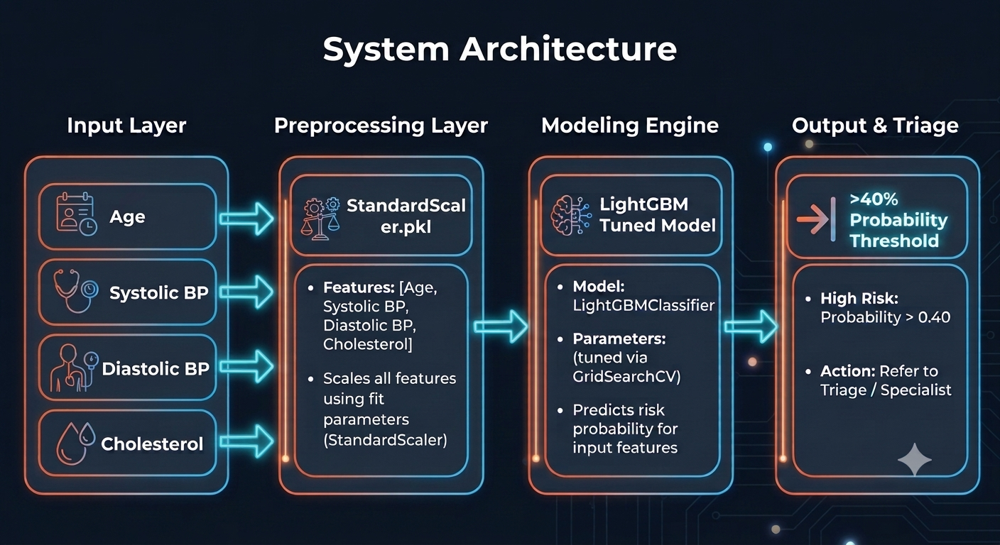

# 👁️ Retinopathy Disease Risk Prediction Tool

An interactive Streamlit web application that uses a fine-tuned **LightGBM** classifier to assess a patient's risk of diabetic retinopathy based on basic clinical parameters.

---

## 📌 Overview

This machine learning tool assists in early clinical screening and risk stratification for retinopathy. By analyzing standard physiological indicators, the model calculates the probability of disease presence with a threshold tuned specifically for high sensitivity (Recall) to minimize false negatives.

---
## 💻 System Architecture

<div align="center">
  
</div>

---

## 🏥 Clinical Context & Ecosystem Impact

### The Healthcare Challenge
Diabetic retinopathy is a leading cause of vision loss. Early detection is critical, but primary care settings often face bottlenecks:
* **Missed Diagnoses (False Negatives):** Failing to flag early risk can lead to delayed specialist referrals and irreversible vision deterioration.
* **Overburdened Specialists:** Unfiltered routine screenings overwhelm ophthalmologists with low-risk cases.

### Target Users & Workflow
1. **Primary Care Physicians & General Practitioners:** Use the Streamlit interface during routine patient checkups to quickly screen vitals (Blood Pressure, Cholesterol, Age) and determine if an immediate referral to an ophthalmologist is warranted.
2. **Clinical Screeners & Health Technicians:** Use the instant risk score (>40% probability threshold) to prioritize patient queues and manage diagnostic follow-up scheduling.

### Key Performance Indicators (KPIs)
* **High Sensitivity (Recall Optimization):** Tuning the decision threshold to strictly minimize false negatives, ensuring high-risk patients are rarely missed.
* **Rapid Triage:** Delivering instant, data-driven risk stratification at the point of care.

---

## 📁 Repository Structure

```text
├── app.py                                                    # Main Streamlit application
├── assets/
│   ├── retinopathy_architecture.png                          # System Architecture
├── notebook/
│   ├── Diabetic_Retinopathy_prediction_In_Patients.ipynb     # Python Notebook
├── Models/
│   ├── standard_scalar.pkl                                   # Pre-trained StandardScaler object
│   └── lgbm_tuned.pkl                                        # Fine-tuned LightGBM model artifact
├── requirements.txt                                          # Python dependencies
└── README.md                                                 # Project documentation

```

---

## 🛠️ Tech Stack

* **Frontend UI:** Streamlit
* **Data Handling:** Pandas
* **Machine Learning:** LightGBM, Scikit-learn
* **Model Serialization:** Pickle

---

## 📊 Model & Clinical Features

The model evaluates four core patient attributes collected via the UI sidebar:

| Feature Name | Field Name | Type | Description |
| --- | --- | --- | --- |
| **Age** | `age` | Integer | Patient age in years (1–120) |
| **Systolic BP** | `systolic_bp` | Float | Systolic blood pressure (mmHg) |
| **Diastolic BP** | `diastolic_bp` | Float | Diastolic blood pressure (mmHg) |
| **Cholesterol** | `cholesterol` | Float | Total serum cholesterol (mg/dL) |

### Decision Threshold

* **High Risk Target (`Probability > 40%`):** Triggers a high-risk warning advising clinical follow-up and diagnostic confirmation.
* **Low Risk (`Probability ≤ 40%`):** Reassures low risk with advice to continue routine monitoring.

---

## 🚀 Quickstart

### Prerequisites

Make sure Python 3.8+ is installed on your machine.

### Installation

1. **Clone the repository:**
```bash
git clone https://github.com/your-username/retinopathy-risk-prediction.git
cd retinopathy-risk-prediction

```


2. **Create and activate a virtual environment (optional but recommended):**
```bash
python -m venv venv
source venv/bin/activate  # On Windows: venv\Scripts\activate

```


3. **Install dependencies:**
```bash
pip install -r requirements.txt

```


*If you do not have a `requirements.txt` file yet, install manually:*
```bash
pip install streamlit pandas lightgbm scikit-learn

```


4. **Verify model files:**
Ensure `standard_scalar.pkl` and `lgbm_tuned.pkl` are placed inside a folder named `Models/` in the project root directory.
5. **Run the Streamlit app:**
```bash
streamlit run app.py

```


---

## ⚠️ Medical Disclaimer

This application is strictly for **educational and screening support purposes**. It is not intended to be a substitute for professional medical advice, diagnosis, or treatment. Always seek the advice of a qualified physician or healthcare provider for clinical decisions.
